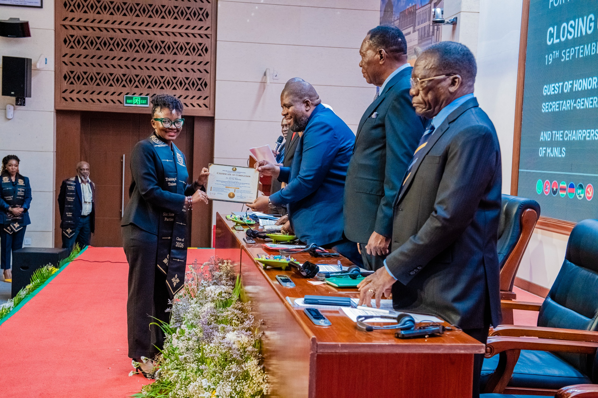
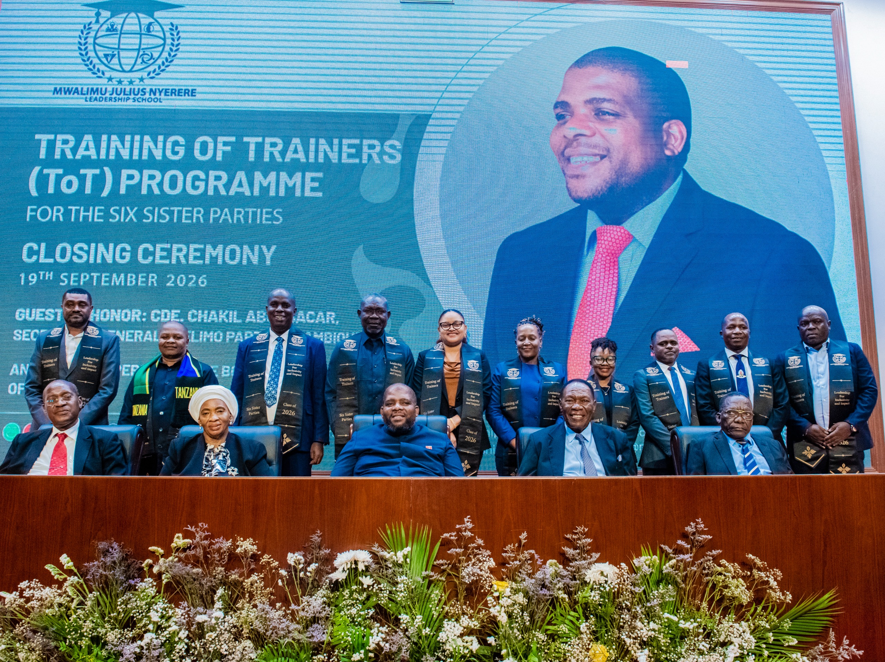

It’s a wrap! I’m delighted to have completed leadership training at the Mwalimu Julius Nyerere Leadership School, alongside fellow cadres representing six sister parties from across Southern and East Africa.

Our group brought together participants from CCM (Tanzania), FRELIMO (Mozambique), SWAPO (Namibia), MPLA (Angola), ZANU-PF (Zimbabwe) and ANC (South Africa). Learning alongside colleagues from different countries created opportunities to exchange experiences and reflect on our shared responsibilities as leaders.

Through the training, we explored leadership, cooperation and the role of knowledge sharing in supporting our communities. The discussions encouraged us to reflect on how we can turn what we learn into practical action and help others develop their own capacity to lead.

Beyond the sessions, the experience strengthened connections across our countries and deepened our sense of unity and shared purpose. It was a reminder that leadership also involves listening, learning from others and working together.

Grateful to the organisers, facilitators and fellow participants for the learning and conversations. I leave better equipped to lead, share knowledge and contribute to the communities I serve.
