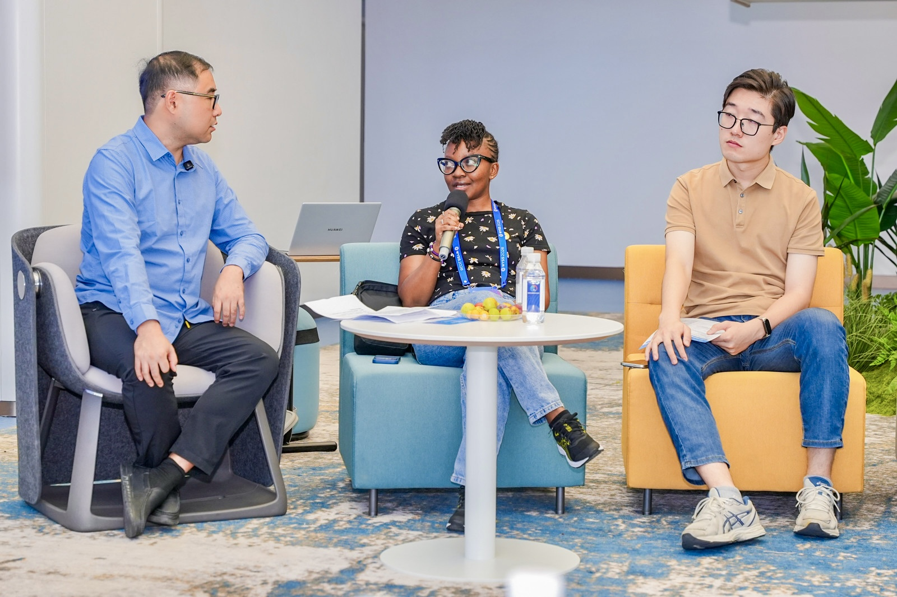
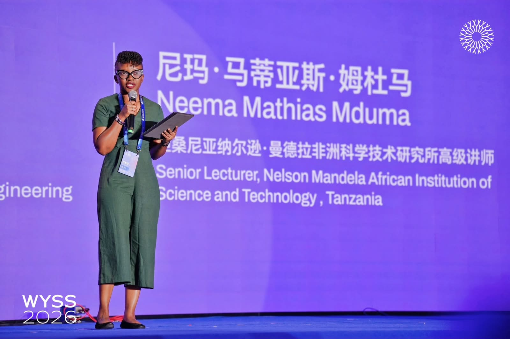

In October 2026, I participated in the World Young Scientist Summit in Wenzhou, China, where I shared my research experience and contributed to discussions on the future of science and technology.

During a round table discussion on smart agriculture and AI, I shared my experience with kilimoAI, highlighting our work to help smallholder farmers identify crop diseases early and make timely crop management decisions.

Drawing on our work in Tanzania, I reflected on the importance of connecting AI research with farmers’ needs and experiences. Developing useful agricultural tools requires reliable field data, collaboration with agricultural experts and continued engagement with the people who use them.

I was also selected to share my views during the “Prospects for Topics at WYSS 2027” discussion. I highlighted AI for Science, quantum information, energy technologies, life sciences and future manufacturing as areas for future summit discussions.

I emphasised the importance of in-depth research within our disciplines while encouraging stronger collaboration across fields. Bringing different perspectives together can help us explore questions and develop solutions that extend beyond a single discipline.

